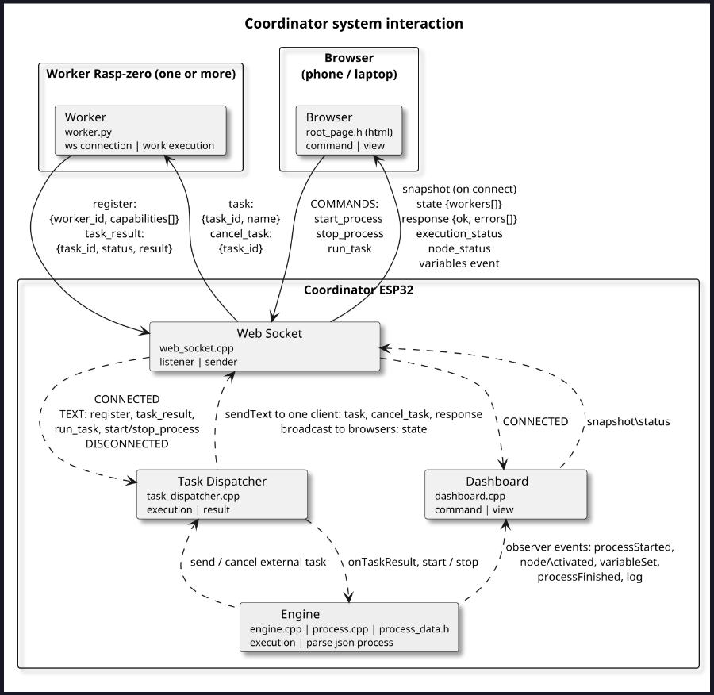

# joda

ESP32 process coordinator. The ESP32 runs its own WiFi access point, executes JSON-defined processes, and dispatches tasks over WebSocket to Raspberry Pi Zero workers. A browser dashboard starts/stops processes and shows live status.

- **Coordinator** (`src/`) — PlatformIO, Arduino framework, `esp32dev`. Build and flash: `pio run -t upload`.
- **Worker** (`_doc/worker/worker.py`) — Python worker that registers its capabilities and executes tasks.
- **Dashboard** — join the `ESP32-Process-Network` WiFi and open http://192.168.4.1 (WebSocket on port 81). Settings in `src/config.h`.
